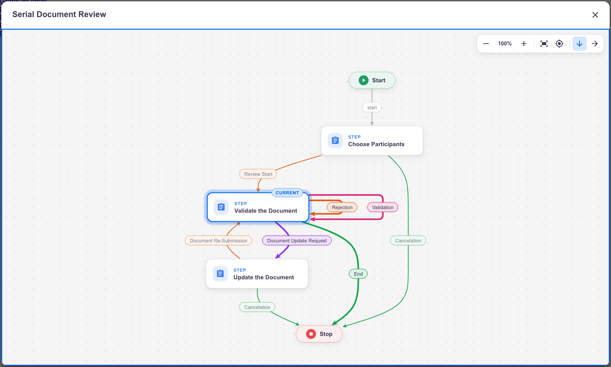
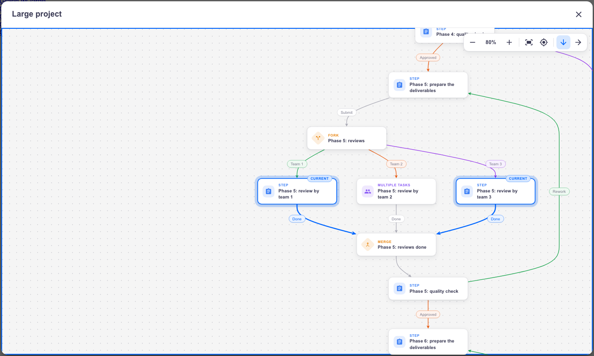
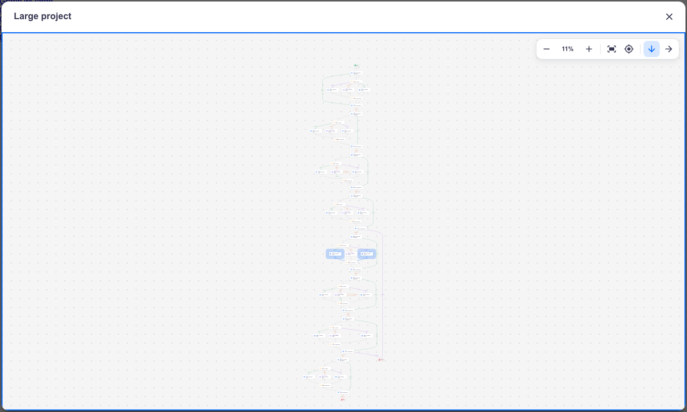
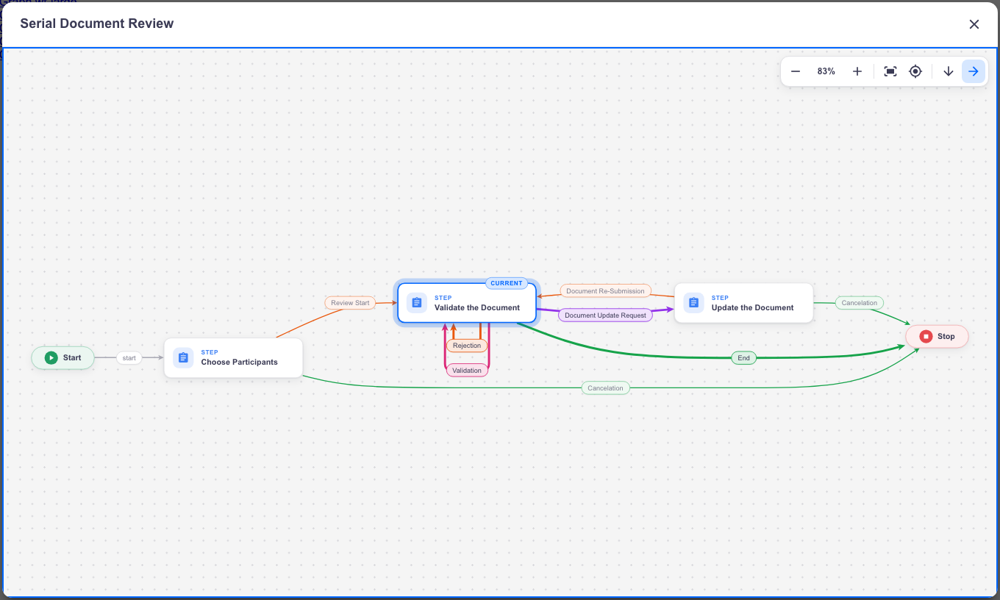
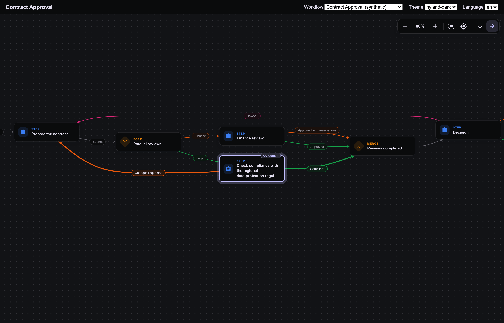
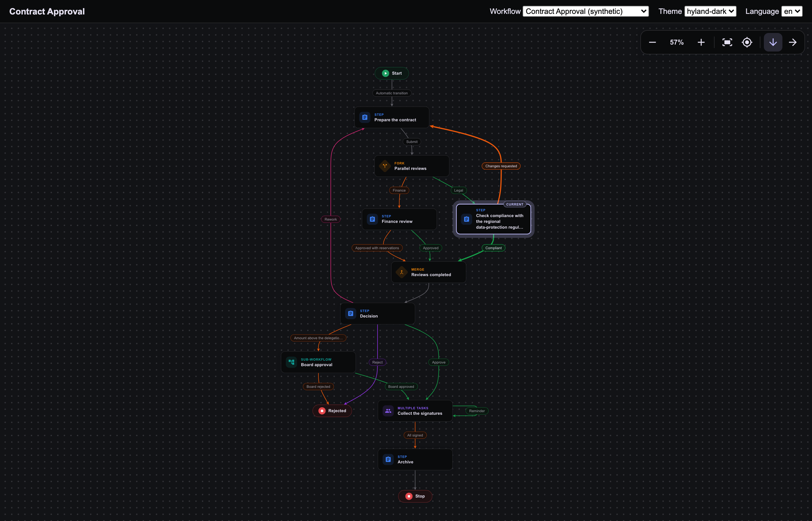
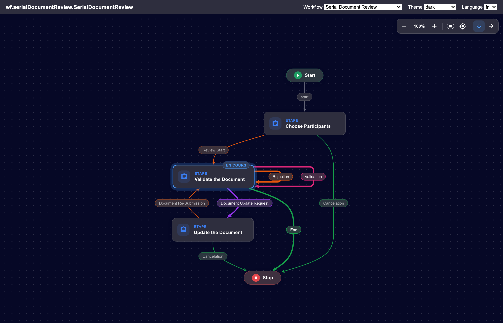

# Nuxeo Labs Workflow Graph

A simple, modern replacement for the **"View Graph"** dialog of Nuxeo Web UI (Nuxeo LTS 2025). The whole workflow
is laid out automatically, top to bottom or left to right, and drawn with themed cards. The transitions leaving a
step get different colors. The current step and the transitions that can follow it are highlighted. The graph is
read-only: no clickable steps, no details panel, no animation. It only has the controls needed to read large
graphs: zoom, fit to screen, center on the current step and the direction of the layout.



| A large workflow opens zoomed on its current steps | `F`: the whole workflow, current steps still visible |
| --- | --- |
|  |  |
|  |  |
|  |  |

> The screenshots come from the development tools described below (mocked data).

## Features

- **Automatic layout** ([dagre](https://github.com/dagrejs/dagre)), top to bottom by default or left to right.
  It ignores the drawing made in Nuxeo Studio, so it stays readable even when the Studio boxes overlap or the
  paths are outdated. Loops back to a previous step are drawn as such, and a transition looping on its own step
  is drawn around that step.
- **Direction kept per workflow**: the direction chosen in the toolbar is kept in the browser (local storage) for
  the workflow model, so a user can read one workflow top to bottom and another one left to right. Every
  instance of a model (e.g. every "Serial Document Review") then opens the same way.
- **Modern rendering**: cards with an icon per kind of step (step, multiple tasks, sub-workflow, fork, merge),
  Start/End pills, transition labels as chips, curved transitions with arrow heads, dotted background.
- **Current step(s)**: colored border, ring and "Current" badge. The ring stays visible at any zoom level, so
  the current steps can be spotted even when the whole graph is fitted. Parallel branches can have several
  current steps.
- **Transition colors**: as in Web UI's default graph, the transitions leaving a step that has several of them
  get different colors (5 colors, reused in turn), so they are easy to follow. A step with a single transition
  uses a neutral color.
- **Next transitions**: the transitions leaving the current step(s) keep their color and are drawn thicker, with
  bigger arrow heads and emphasized labels, on top of the other transitions. A single one is drawn in the
  highlight color.
- **Static**: no hover effect, no selection, no dimming, no animation. Every view change is instant.
- **Opening**: the graph is fitted to the dialog. When it would then be displayed under 50%, the view zooms to
  80% on the current step instead (press `F` to see the whole graph). Switching the direction resets the view
  the same way.
- **Themes**: follows the Web UI theme (default, dark, Hyland light and dark); the main colors can be changed
  with CSS variables (see [Colors](#colors)).
- **Translations**: English and French. Labels coming from the workflow definition are translated as in Web UI.
- **Safe**: if the plugin is disabled or the graph cannot be drawn, Web UI's default graph is opened.

## Keyboard, mouse and touch

| Action | Toolbar | Keyboard | Mouse / touch |
| --- | --- | --- | --- |
| Zoom in / out | `+` / `−` | `+` (or `=`) / `-` | pinch (touch screen, trackpad), Ctrl/⌘ + wheel |
| Fit to screen | fit button | `F` | |
| Center on the current step | target button | `C` (repeat to go to the next current step) | |
| Top to bottom / left to right | `↓` / `→` (the active one is highlighted) | | |
| Pan | | | drag, wheel (Shift + wheel: horizontally) |
| Close | close button | `Escape` | |

The toolbar shows the zoom level (5% to 250%). The keys work once the graph has the focus: it has it when the
dialog opens, and after a click on the graph. Inside the dialog, keys are not propagated to Web UI's global
shortcuts (`d`, `m`, `c`, `/`...).

## How it works (front end only)

- The data comes from the existing REST API: `GET /api/v1/workflow/{id}/graph` (steps, kinds, states,
  transitions and their labels) and `GET /api/v1/workflow/{id}` (title of the dialog and name of the workflow
  model, optional). Both are requested in parallel. No server-side code is needed.
- Web UI's default graph is the `nuxeo-workflow-graph` element (jsPlumb, fixed 880x720 canvas, Studio positions).
  It is used by the document workflow bar and by the task view, which both only call its `show()` method. The
  element cannot be redefined, so this plugin **patches `show()`** once the element is defined: the plugin's
  dialog is created inside the element (where the default dialog lives) and the original `show()` is kept as a
  fallback. No Web UI file is modified.
- A step is "current" when its state is `suspended` (waiting for its tasks), as in Web UI.
- The direction is stored only when the user chooses left to right, under the key
  `nuxeo-labs-workflow-graph.direction.model.<workflowModelName>` of the browser's local storage (going back to
  top to bottom removes it). Nothing is stored on the server, so the choice is per browser.

| Call | If it fails |
| --- | --- |
| `GET /api/v1/workflow/{id}/graph` | the dialog closes and Web UI's usual error message is shown |
| `GET /api/v1/workflow/{id}` | the title is "Workflow", and the direction is kept for this workflow instance only |
| Layout or drawing error | the dialog closes and Web UI's default graph is opened |

## Installation

Build with Maven (Java 21, Maven 3.8+):

```bash
mvn clean install
```

and install the package
`nuxeo-labs-workflow-graph-package/target/nuxeo-labs-workflow-graph-package-2025.1.0-SNAPSHOT.zip`:

```bash
nuxeoctl mp-install /path/to/nuxeo-labs-workflow-graph-package-2025.1.0-SNAPSHOT.zip
```

Requires Nuxeo LTS 2025 with the `nuxeo-web-ui` package. After the installation (restart), the "View Graph" links
of the document page and of the task view open the new dialog.

> This package conflicts with `nuxeo-labs-custom-workflow-graph` (the detailed, interactive version of this
> viewer): both replace the same dialog, install only one of them.

## Configuration

| Property | Default | Description |
| --- | --- | --- |
| `org.nuxeo.web.ui.labsWorkflowGraph.enabled` | `true` | `false`: Web UI's default graph is used, as if the plugin was not installed |

The property is exposed to Web UI as `Nuxeo.UI.config.labsWorkflowGraph.enabled` and read each time a graph is
opened. To change it, contribute it again, for example from Studio (Configuration > XML Extensions):

```xml
<require>nuxeo.labs.workflowgraph.properties</require>
<extension target="org.nuxeo.runtime.ConfigurationService" point="configuration">
  <property name="org.nuxeo.web.ui.labsWorkflowGraph.enabled">false</property>
</extension>
```

### Colors

By default, the colors derive from the Web UI theme variables (`--nuxeo-text-default`, `--nuxeo-box`,
`--nuxeo-page-background`, `--nuxeo-focus-ring-color`, `--nuxeo-primary-color`...), so the graph follows the theme
without any configuration.

**CSS variables are the way to change them.** The graph is drawn inside shadow DOM (the one of Web UI's
`nuxeo-workflow-graph` element, then the one of the plugin's dialog): a regular CSS rule written in a page, a theme
or a Studio bundle, such as `.lwg-node { border-color: red; }`, never reaches it. CSS custom properties (variables)
are inherited through shadow DOM boundaries: set them on `html`, the graph reads them.

| Variable | Default | Used for |
| --- | --- | --- |
| `--lwg-current` | `--nuxeo-focus-ring-color`, else `--nuxeo-primary-color` | current steps (border, ring, badge), and the transition leaving a current step when it is its only one |
| `--lwg-transition-1` to `--lwg-transition-5` | `#16a34a` (green), `#ea580c` (orange), `#9333ea` (purple), `#db2777` (pink), `#0891b2` (cyan) | transitions of a step that has several of them, see below |
| `--lwg-edge` | mix of `--lwg-text` and `--lwg-bg` | transitions of a step that has a single one |
| `--lwg-color-start`, `--lwg-color-end` | `#1f9d63`, `#e5484d` | Start and End pills |
| `--lwg-color-step`, `--lwg-color-multi`, `--lwg-color-sub`, `--lwg-color-gateway` | `#3b7ff5`, `#8b5cf6`, `#0f9f96`, `#e8830c` | kinds of steps (icon and caption; gateway = fork and merge) |
| `--lwg-bg` | `--nuxeo-page-background` | canvas |
| `--lwg-card-bg` | `--nuxeo-box` | steps, labels and toolbar |
| `--lwg-text` | `--nuxeo-text-default` | text |
| `--lwg-grid` | mix of `--lwg-text` and `--lwg-bg` | dots of the canvas |

**Transition colors.** The transitions leaving the same step are told apart by their rank in the step (the order
of the workflow definition): the first one uses `--lwg-transition-1`, the second `--lwg-transition-2`, and so on;
after the fifth, the colors are reused (7 transitions: 1, 2, 3, 4, 5, 1, 2). The color depends on the rank only,
not on the meaning of the transition: the graph REST endpoint gives no transition id, only its source, target and
label. The labels get a border and a light background of the transition color; their text keeps the text color, so
it stays readable whatever the color.

**Derived colors.** Some colors have no variable of their own and are computed (`color-mix()`) from the ones
above: borders of the steps and of the labels, muted text (labels, captions), toolbar hover, and the light tints of
the ring, the badge, the labels and the Start/End pills. Change the base colors to change them. The icon of the
Start/End pills is always white.

**Example.** Variables can be set:

- in the custom bundle of a Studio project (`nuxeo-<projectId>-custom-bundle.html`, imported by the main bundle):
  the values apply to every theme;
- in a Web UI theme (`themes/<name>/theme.html`): the values apply to this theme only, e.g. to have different
  colors in a light and in a dark theme.

```html
<custom-style>
  <style is="custom-style">
    html {
      /* current step */
      --lwg-current: #c2410c;
      /* transitions of a step that has several of them */
      --lwg-transition-1: #15803d;
      --lwg-transition-2: #b91c1c;
      --lwg-transition-3: #1d4ed8;
      --lwg-transition-4: #a16207;
      --lwg-transition-5: #6d28d9;
      /* steps and canvas */
      --lwg-card-bg: #fffdf7;
      --lwg-bg: #f4f1ea;
    }
  </style>
</custom-style>
```

To try values without deploying anything, open a graph and run in the browser console:

```js
document.documentElement.style.setProperty('--lwg-transition-1', 'crimson');
```

Variables starting with `--_lwg-` are internal: they are redefined by the graph, setting them has no effect.

## Architecture

```
nuxeo-labs-workflow-graph-web/src/main/resources/
├── META-INF/MANIFEST.MF
├── OSGI-INF/
│   ├── deployment-fragment.xml        copies the web resources, merges the translations
│   ├── lwg-webresources-contrib.xml   registers the bundle HTML with Web UI
│   └── lwg-properties-contrib.xml     the "enabled" setting
└── web/nuxeo.war/ui/
    ├── i18n/messages.json, messages-fr.json
    └── nuxeo-labs-workflow-graph/
        ├── nuxeo-labs-workflow-graph-bundle.html   entry point (script order)
        ├── lwg-core.js                namespace, setting, directions (storage), translations, text measuring, model
        ├── lwg-layout.js              geometry helpers and the layout, top to bottom or left to right (dagre)
        ├── lwg-icons.js               inline SVG icons (Material Icons)
        ├── lwg-styles.js              CSS of the graph (no animation)
        ├── lwg-renderer.js            LWG.Renderer: drawing, zoom, pan, fit, center, direction (framework-free)
        ├── nuxeo-labs-workflow-graph-dialog.html   Polymer dialog: title, loading, graph, direction memory
        ├── lwg-override.js            patch of nuxeo-workflow-graph.show()
        └── vendor/dagre.min.js        dagre 3.1.3 (MIT), unmodified
```

Plain JavaScript and HTML imports, like Web UI add-ons built without a JS toolchain: no npm build is needed and
the Maven build only packages the files.

## Development

The `dev/` folder is not packaged. Nothing is installed by the project: the browser tool uses an existing
`node_modules` folder and an existing Chrome.

| Command | What it does |
| --- | --- |
| `node --test dev/test` | Unit tests of the setting, directions and their storage, translations, model (including the transition colors), geometry and layout (every sample in both directions: steps placed without overlap, transitions attached to their steps, labels off the steps). Node 20+, no dependency |
| `python3 -m http.server 8765` then `http://localhost:8765/dev/demo/index.html` | Demo of the renderer with the sample workflows, themes and languages (URL parameters: `wf`, `theme`, `lang`, `dir` to force `TB` or `LR`; otherwise the direction is kept per sample, as in the dialog) |
| `node dev/tools/screenshots.mjs [filter]` | Renders every sample in every theme (and left to right) in headless Chrome and writes `dev/out/demo/*.png`, then checks the interactions: initial view (zoom on the current step for a large graph), `F`, `C` (cycling), `+`, `-`, minimum zoom, toolbar, Ctrl + wheel, wheel, drag, no animation, steps not focusable, transition colors, color overrides, direction switch (view reset, kept per workflow, not stored for TB). Fails on any console error or warning. Filter `checks`: interaction checks only |

Environment variables of the browser tool:

| Variable | Description |
| --- | --- |
| `LWG_NODE_MODULES` | `node_modules` folder containing `puppeteer-core` |
| `CHROME_PATH` | Chrome or chrome-headless-shell executable (default: Google Chrome on macOS) |

The samples (`dev/demo/samples.js`) are SerialDocumentReview, ParallelDocumentReview and MainWF rebuilt from the
Nuxeo sources, plus two synthetic workflows: "contract" (fork, merge, loops, sub-workflow, long titles) and
"large" (59 steps, two current steps in parallel branches).

## Third-party code

- [dagre](https://github.com/dagrejs/dagre) 3.1.3, MIT License (`vendor/dagre.LICENSE.txt`), unmodified
  `dist/dagre.min.js` (SHA-256 `54a503e346f93ca0bb10abe7999587e037262935687aca45eb4e4b0f64bbb578`).
- Material Icons by Google, Apache License 2.0 (SVG paths in `lwg-icons.js`).

## License

[Apache License 2.0](http://www.apache.org/licenses/LICENSE-2.0)

## About Nuxeo

Nuxeo Platform is an open source Content Services platform, written in Java and part of Hyland. Data can be stored
in both SQL & NoSQL databases. Learn more at [hyland.com](https://www.hyland.com).
